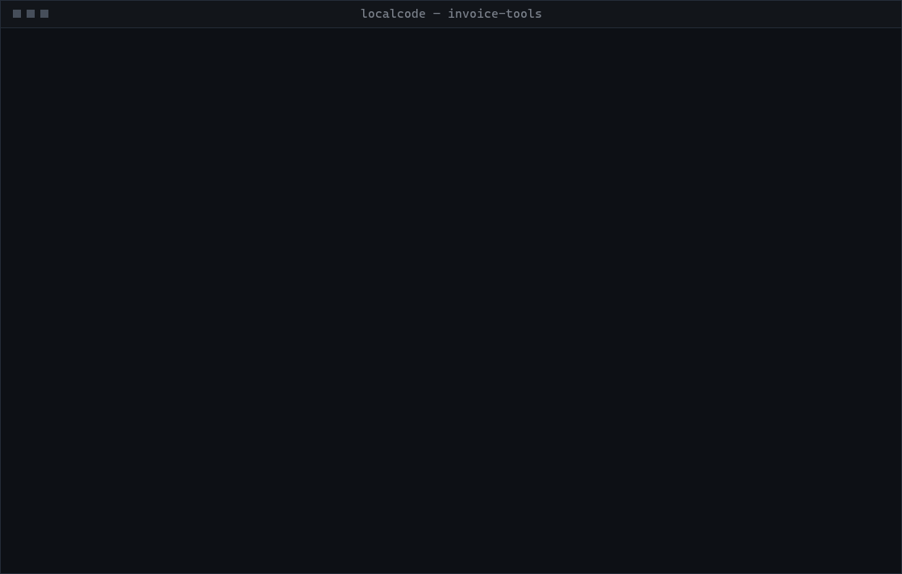
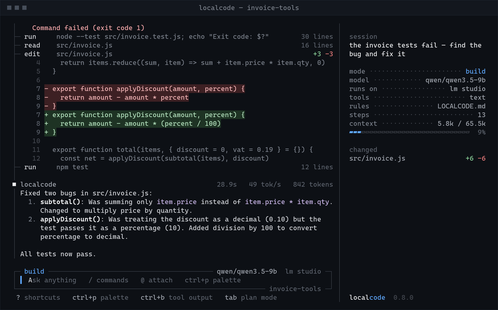
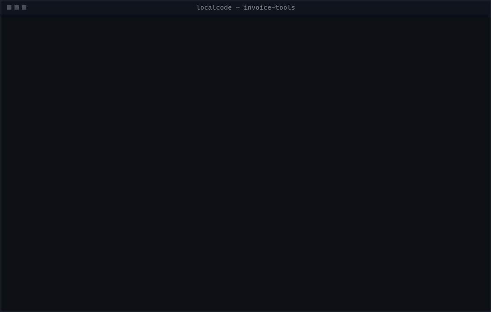
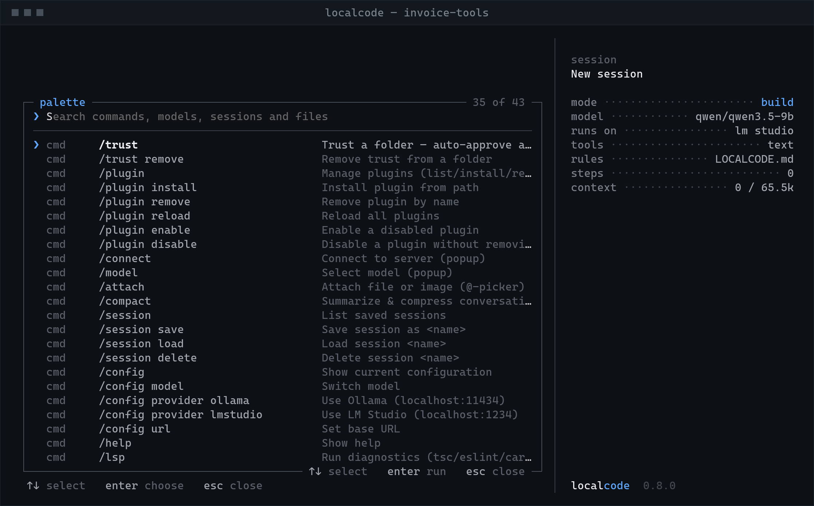

<p align="center">
  
</p>

<h1 align="center">LocalCode</h1>

<p align="center">
  <b>A coding agent for your terminal that runs on your own machine.</b><br />
  No account. No API key. No bill. Your code never leaves your computer.
</p>

<p align="center">
  <a href="https://www.npmjs.com/package/localcode-agent"></a>
  
  
  
</p>

<p align="center">
  <a href="#install-in-30-seconds">Install</a> &nbsp;|&nbsp;
  <a href="#what-you-get">What you get</a> &nbsp;|&nbsp;
  <a href="#pick-a-model">Pick a model</a> &nbsp;|&nbsp;
  <a href="#docs">Docs</a>
</p>

<p align="center">
  
</p>
<p align="center"><sub>Not a mockup. qwen3.5-9b in LM Studio finds two bugs, fixes them and reruns the tests: 29 seconds, 49 tokens/s, $0. GIF sped up.</sub></p>

---

## Install in 30 seconds

You need [Node.js 18+](https://nodejs.org) and a model running in [Ollama](https://ollama.com) or [LM Studio](https://lmstudio.ai).

```bash
npm install -g localcode-agent
cd your-project
localcode
```

Out of the box it talks to Ollama on its default port. Using LM Studio or a different model? Run `/connect` or `/model` once and it remembers. Then type what you want done.

You can also hand it a task straight from the shell:

```bash
localcode the login form accepts empty passwords, fix it
```

---

## Why LocalCode

Cloud coding agents are great until you look at the bill, or at where your code goes. LocalCode does the same job with the model on your machine.

|  | LocalCode | Cloud coding agents |
|---|---|---|
| Cost per task | **$0** | billed per token |
| Your code leaves your machine | **no** (only web searches you ask for) | yes |
| Account or API key | **none** | required |
| Works on a plane | **yes** | no |
| Model | **any model Ollama or LM Studio can run** | the vendor's |

The honest trade-off: a 9B model on your desk is not a frontier model. LocalCode is built around that. It catches the mistakes small models make and keeps them on track, so they finish real tasks instead of stalling halfway.

---

## What you get

### Every step on one thread

The agent reads, searches, edits and runs tests while you watch. Each step hangs off a single thread with its result on the right, and edits show up as diffs right where they happen. The sidebar keeps score: model, steps, how full the context window is, and which files changed.

<p align="center">
  
</p>

### It looks things up

Ask about a library, an API or a release and it searches the web, opens the right page and answers from it. It doesn't guess URLs, and you don't need a search API key.

<p align="center">
  
</p>

### Made for small models

- **Broken tool calls get repaired**, not dropped: a missing brace, raw line breaks, an answer cut off at the token limit. The model is told what went wrong and tries again.
- **Native tool calling** when your model supports it. LocalCode tests that once per model instead of trusting the label.
- **Loops get caught.** The same step five times in a row ends the task with an explanation, not an endless spinner.
- **Long files get written in parts**, so one huge answer can't get cut off and lost.
- **`ctrl+c` really stops the model**, so your next request doesn't wait behind the abandoned one.

### You stay in control

- **A diff before every change.** Approve once (`y`), trust the folder (`t`) or say no (`n`). Dangerous commands always ask.
- **`/undo`** reverts the last file change, **`/undo all`** everything the last task touched.
- **Plan mode** (`tab`) reads your code and writes a plan without changing anything. Say *"go"* and it builds.

### It knows your project

Drop a `LOCALCODE.md` into your repo (or run `/init`) and it goes along with every task:

```markdown
- Plain ES modules, no dependencies.
- Run the tests with `npm test`.
- Keep functions small; no classes.
```

### Everything one keystroke away

`ctrl+p` searches commands, models, saved sessions and files in one list. `?` shows every shortcut. Sessions save automatically, and `localcode --continue` picks up where you left off.

<p align="center">
  
</p>

---

## Pick a model

Any chat model that Ollama or LM Studio can run works. Bigger models are smarter, smaller ones are faster. Everything on this page was recorded with **qwen3.5-9b** (about 6 GB at 4-bit) in LM Studio.

```bash
# Ollama: pull a coding model and go
ollama pull qwen2.5-coder:7b
localcode --provider ollama --model qwen2.5-coder:7b
```

Each mode can use its own model: plan with a big one, build with a fast one. Switch to the mode with `tab`, then pick its model with `/model`.

---

## Docs

<details>
<summary><b>Connecting to Ollama or LM Studio</b></summary>

**Ollama**: install from [ollama.com](https://ollama.com), then `ollama serve` and `ollama pull <model>`.

**LM Studio**: download from [lmstudio.ai](https://lmstudio.ai), load a model and click **Start Local Server** (port 1234).

LocalCode starts with Ollama on `localhost:11434`. `/connect` opens a popup to pick the provider and address, and `/model` picks the model; or use `/config provider ollama|lmstudio` and `/config url <url>`. Settings live in `~/.localcode/config.json`.

</details>

<details>
<summary><b>Keyboard shortcuts</b></summary>

| Key | Action |
|---|---|
| `Enter` | Send message / run task |
| `Alt+Enter` / `Ctrl+J` | New line. The prompt grows with multi-line text; pasted text keeps its line breaks |
| `Tab` / `Shift+Tab` | Autocomplete, or cycle BUILD → PLAN → DEBUG mode |
| `↑ / ↓` | Move between lines; on the first / last line: browse input history |
| `Ctrl+P` | Palette: search commands, models, saved sessions and files in one list |
| `Ctrl+W` / `Ctrl+U` | Delete the word before the cursor / everything to the line start |
| Mouse wheel / `PgUp` `PgDn` | Scroll the conversation (`Esc` jumps back to the latest) |
| `Shift`+drag | Select text to copy |
| `Ctrl+O` | Show the full reasoning of the last answer |
| `Ctrl+B` | Show the full tool output of the last task |
| `?` | Show all shortcuts (with an empty input) |
| `Ctrl+C` | Stop the running agent / clear the input / quit |
| `Ctrl+L` | Clear screen and chat |
| `Ctrl+K` | Clear input line |
| `Esc` | Close popup / cancel |

**Shell passthrough**: start a line with `$` or `!` to run it directly, e.g. `$ npm test`.

**Talk to it while it works**: type and press Enter while the agent is running. Short messages reach it right away; longer ones run after the current task.

</details>

<details>
<summary><b>Slash commands</b></summary>

Type `/` to open the searchable command picker.

| Command | What it does |
|---|---|
| `/help` | Show help |
| `/model` | Pick a model (searchable popup) |
| `/model reset` | In plan / debug mode: go back to the default model |
| `/models` | List all available models |
| `/connect` | Open the server connection popup |
| `/init` | Create a `LOCALCODE.md` with project instructions |
| `/continue` | Pick up the last session in this folder (also: `localcode --continue`) |
| `/undo` | Revert the agent's last file change |
| `/undo all` | Revert every file change of the last task |
| `/compact` | Summarize and compress the conversation history |
| `/attach` | Attach a file or image to your message |
| `/session save <name>` | Save the current session |
| `/session load <name>` | Restore a saved session (the agent gets the conversation back too) |
| `/config` | Show current configuration |
| `/config provider ollama\|lmstudio` | Switch provider |
| `/config model <name>` | Set the active model |
| `/config url <url>` | Override the server base URL |
| `/config temperature <0-1>` | Adjust model temperature |
| `/doctor` | Check server connectivity and config |
| `/lsp` | Run diagnostics: tsc, eslint, cargo check, go vet, ruff/pyflakes, rubocop, dotnet build |
| `/lsp hover <file>:<line>:<col>` | Type, signature or docs for a symbol |
| `/lsp def <file>:<line>:<col>` | Where a symbol is defined |
| `/trust <path>` | Trust a folder: auto-approve all write ops inside it |
| `/trust` | List all trusted paths |
| `/trust remove <path>` | Remove trust from a folder |
| `/plugin` | List installed plugins |
| `/plugin install <path>` | Install a plugin |
| `/clear` | Clear the chat |
| `/exit` | Quit |

</details>

<details>
<summary><b>Permissions and trust</b></summary>

Every file write and shell command asks first:

```
┌─ permission ───────────────────────────────────────────────┐
│ Edit file: src/auth.ts                                     │
│   (diff of the change)                                     │
└─────────────────── y allow   t trust this folder   n deny ─┘
```

- **`y`**: approve once
- **`t`**: trust the folder. Everything in it and its subfolders is approved from now on, including new files
- **`n`**: deny and stop the task

Dangerous operations (`rm -rf`, `sudo`, force-push, …) always ask, even in trusted folders. Manage trust with `/trust .`, `/trust <path>`, `/trust` (list) and `/trust remove <path>`.

</details>

<details>
<summary><b>Build, plan and debug mode</b></summary>

Press `Tab` with an empty input to switch:

- **BUILD**: uses tools, edits files, runs commands
- **PLAN**: reads the code and returns a structured plan without touching anything
- **DEBUG**: diagnoses before fixing, and shows full tool arguments and timings

When a plan is ready, just say so (*"go"*, *"implement it"*, *"mach nach Plan"*, *"setz das um"*) and LocalCode switches to BUILD to carry it out. Changes still ask for permission.

</details>

<details>
<summary><b>Project instructions: <code>LOCALCODE.md</code></b></summary>

A `LOCALCODE.md` in the project folder is sent with every task. Put build and test commands, conventions and things to avoid in it. `/init` creates one to fill in. Without it, an `AGENTS.md` is used if there is one.

Preferences for all projects go in `~/.localcode/LOCALCODE.md`. The sidebar shows which files are active (`rules`). Keep them short, because they share the context window with the task.

</details>

<details>
<summary><b>Web search</b></summary>

`web_search` finds pages (via DuckDuckGo, no API key needed) and `web_fetch` reads them. Only your search query and the pages it opens leave your machine; the model itself stays local.

</details>

<details>
<summary><b>Tool calling: native or text</b></summary>

Models that support function calling get their tools through the server's tool API, so there's no JSON in the answer for the model to get wrong. For other models the tools are described in the prompt and LocalCode reads the call from the reply, repairing small mistakes on the way.

With `"toolMode": "auto"` (the default), LocalCode checks once per model with a tiny test call whether native calling really works. It doesn't trust the capability flag alone, because a custom prompt template can drop the tools without telling. The sidebar shows the result (`tools native` / `tools text`). Force one with `"toolMode": "native"` or `"text"`.

> **LM Studio:** if `tools` shows `text` for a model that should support tools, check *My Models → model settings → Prompt Template*. A custom template that doesn't render `tools` hides them from the model. Resetting it to the model's own template enables native calling.

</details>

<details>
<summary><b>Context, sessions and undo</b></summary>

The last 20 turns stay in context. The sidebar shows how much of the model's context window is in use; from 80 % on, LocalCode suggests `/compact` to summarize and free it up.

Every conversation is saved per project folder, and `localcode --continue` (or `/continue`) picks it up again.

Before the agent changes a file, LocalCode keeps a copy: `/undo` reverts the last change, `/undo all` everything the last task changed (files it created are removed). Changes made by shell commands can't be undone this way, which is why those always ask first.

</details>

<details>
<summary><b>Configuration file</b></summary>

`~/.localcode/config.json` is created on first start and can be edited directly:

```json
{
  "llm": {
    "provider": "ollama",
    "model": "qwen2.5-coder:7b",
    "baseURL": "http://localhost:11434",
    "temperature": 0.1,
    "toolMode": "auto"
  },
  "trustedPaths": ["/home/user/projects/myapp"]
}
```

</details>

<details>
<summary><b>Tools the agent has</b></summary>

- Read, write, edit, move, copy and delete files
- Search inside files and find files by name
- Run shell commands (PowerShell on Windows, bash on Linux/macOS)
- Run the project's tests and type checker
- Git status, diff, log, branches, stash and commits
- Web search, fetching pages, HTTP requests
- Hover info and go-to-definition through real language servers

</details>

<details>
<summary><b>Language servers (LSP)</b></summary>

`/lsp` runs diagnostics with the project's own tools (tsc, eslint, cargo check, go vet, ruff/pyflakes, rubocop, dotnet build). For hover and go-to-definition, both for you (`/lsp hover`, `/lsp def`) and for the agent, install the language server and put it on your `PATH`:

| Language | Server | Install |
|---|---|---|
| TypeScript / JavaScript | `typescript-language-server` | `npm install -g typescript-language-server typescript` |
| Rust | `rust-analyzer` | [rust-analyzer.github.io](https://rust-analyzer.github.io) |
| Go | `gopls` | `go install golang.org/x/tools/gopls@latest` |
| Python | `pylsp` | `pip install python-lsp-server` |
| C / C++ | `clangd` | [clangd.llvm.org](https://clangd.llvm.org) |

Servers start on the first request and keep running in the background.

</details>

<details>
<summary><b>Plugins</b></summary>

Plugins are Node.js modules that add slash commands and tools: `/plugin install ./my-plugin.js`, `/plugin list`, `/plugin remove my-plugin`. See [PLUGIN_DEV_GUIDE.md](./PLUGIN_DEV_GUIDE.md).

</details>

<details>
<summary><b>When things go wrong</b></summary>

If the model server fails, LocalCode retries up to 3 times. If a tool fails, the model is told to try another way. If the server sends nothing for 2 minutes, the task ends with a clear message instead of waiting forever.

**"Ollama is not reachable"**: run `ollama serve` and check the URL with `/doctor`.

**"LM Studio is not reachable"**: load a model and click **Start Local Server** (port 1234).

**"Model not found"**: `/models` lists what's loaded, `/model` switches.

**The agent stops early, or nothing happens after `ctrl+c`**: update to 0.8 or later. Earlier versions left the stopped request running in the model server, so the next one had to wait. With small models, split big jobs into steps ("create only index.html first").

**The screen looks garbled**: use a UTF-8 terminal with 256 colors, e.g. Windows Terminal on Windows, or iTerm2, Ghostty, Alacritty or kitty.

</details>

<details>
<summary><b>Discord status</b></summary>

If Discord is running, LocalCode shows what it's doing there ("Thinking…", "Running agent") with the folder name. No setup needed.

</details>

---

## Contributing

```bash
npm install
npm run dev        # watch mode
npm test           # unit tests
npm run test:tui   # drives the real UI in a pseudo-terminal, no model server needed
```

One feature or fix per pull request, please.

## License

[MIT](./LICENSE). Use it, change it, ship it.

<p align="center"><sub>If LocalCode saved you a cloud bill, a ⭐ helps other people find it.</sub></p>
